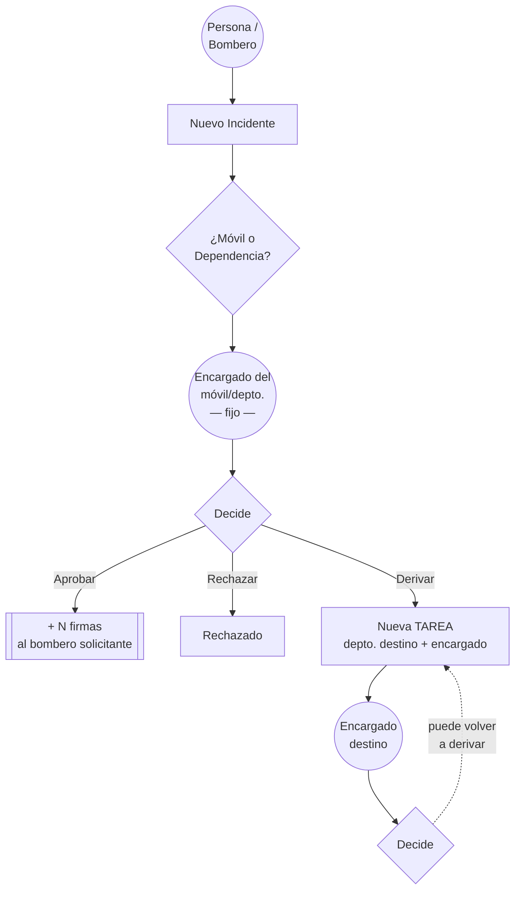

# Módulo de Incidentes — requerimiento

> **Estado: VALIDADO por José el 2026-07-25.** Respondió las 10 preguntas del borrador y las 3 de
> seguimiento. **No está commiteado.**
>
> Queda **1 ambigüedad** (§7) que conviene cerrar antes de tocar el modelo.

## Fuentes de verdad

| Fuente | Peso |
|---|---|
| 📷 **La pizarra** — reunión con **Agustín (PO)** del **01/12/2025** | ✅ **La que más pesa** |
| 🗣️ Las respuestas de José (2026-07-25) | ✅ Autoritativas |
| 📦 El código actual de la rama (`.cs` + `Enums/Firmas/`) | ✅ Implementa la pizarra |
| 🕰️ El modelo de Bernardo (17–21/11/2025) | ⚠️ **Pre-PO** — ver §4 |
| 🚫 Los `.razor` de `Pages/Firmas/` y `TipoIncidente` | ❌ Descartados — **ya borrados** |

Etiquetas: ✅ **Confirmado** · 🔶 **Inferido** · ❓ **Abierto**

---

## 1. Línea de tiempo

| Fecha | Hito |
|---|---|
| 2024-01 → 2025-09 | Iteración vieja (`.razor`, `TipoIncidente`) — 🚫 descartada |
| **2025-11-13** | **PURGE** (`883db077`) — *"reiniciar desde cero"* + migración `FirmasPurge` |
| 2025-11-17 | `05db43d4` — Bernardo implementa el diagrama de clases de José |
| 2025-11-21 | `05b9fea8` — agrega `Mantenimiento` + comentarios de ruteo ⚠️ pre-PO |
| **2025-12-01** | **Reunión con Agustín (PO) → la pizarra. Cambian cosas.** |
| 2026-04-13 | `stash@{2}` (`ae0fd108`) — José implementa los cambios del PO |
| 2026-07-25 | Stash acomodado a `FireForce.*`, legacy borrado, requerimiento validado |

---

## 2. Estado del código

**Existe** (código muerto, compila pero nada lo referencia): `IncidenteBase`, `IncidenteMovil`,
`IncidenteDependencia`, `Tarea`, `MovimientoIncidente` + los 4 enums de `Enums/Firmas/`.

**No existe**: `DbSet`, configuración en `OnModelCreating`, tabla, migración, servicio, DI.
Ni sistema de puntajes en ninguna parte de los 4 proyectos ni de las 52 ramas.

**Borrado el 2026-07-25** (recuperable desde git): la carpeta `Pages/Firmas/` completa,
`Enums/TipoIncidente.cs`, y las 7 referencias de navegación (2 ítems de menú, 2 helpers de
título/breadcrumb, la tarjeta del dashboard + su método + su CSS).
⚠️ "Firmas" ya no aparece en el menú ni en el dashboard hasta que construyamos el módulo.
`Legajo.razor` **no se tocó**.

---

## 3. El requerimiento

### 3.1 Objetivo

Tracking de incidentes sobre **móviles/embarcaciones** y **dependencias** (departamentos del
cuartel). ✅ **DETALL** —el departamento que lleva la parte burocrática— es quien encomendó el sistema.

### 3.2 El flujo — ✅ CONFIRMADO

1. Una persona genera un **Nuevo Incidente**, sobre un **móvil** o una **dependencia**.
2. El incidente queda asignado al **encargado** de ese móvil o dependencia.
   ✅ **Siempre al que corresponda** — y ese encargado **no cambia nunca**.
3. El encargado tiene **tres opciones**:
   - **Aprobar** — y si corresponde, otorgar firmas
   - **Rechazar**
   - **Derivar a otro departamento** → ✅ **esto se hace creando una `Tarea`**, donde se indica el
     departamento destino y su encargado
4. El encargado receptor puede hacer lo mismo → la cadena continúa.

> ✅ **Clave: derivar = crear una Tarea.** El incidente conserva siempre su encargado original;
> la cadena de derivaciones vive en las `Tarea`s. Por eso `Tarea` tiene `Dependencia` + `Encargado`.
>
> Corolario: el evento de derivación ya está en el enum — es **`TipoMovimiento.CreacionDeTarea`**.
> No hace falta un valor `Derivacion`, ni un estado `Derivado` en `EstadoIncidente`.



### 3.3 Reglas de negocio — ✅ CONFIRMADAS

**Quién puede crear qué:**

| Solicitante | Categorías que puede crear |
|---|---|
| **Bombero** | **Todas** (Novedad, Gestión, Limpieza, Mantenimiento, Puesta en marcha) |
| Cualquier otra `Persona` (comisión directiva, cobrador…) | **Solo `Novedad`** |

**Firmas:**

- Se otorgan **por Incidente** (no por tarea), al **aprobar**.
- Las recibe **el bombero que inició el incidente** (el `Solicitante`).
- El encargado decide **cuántas** — no es una constante. Ej.: 5 firmas por una limpieza.
- ✅ **`Novedad` no otorga firmas.** Ej. de novedad: *"el tubo de oxígeno 4 está casi vacío"*.
  Ej. que sí otorga: *"se limpió la caja del móvil 1"*.
- ✅ **Nunca se otorgan firmas a una `Persona` que no es `Bombero`.**
- "Firmas" es como le dicen ellos; **cada firma = 1 punto**. El **sistema de puntajes no entra en
  este módulo**, pero lo consume.

> 🔶 **Los dos invariantes se refuerzan entre sí**: la única categoría que puede crear un no-bombero
> (`Novedad`) es exactamente la que no otorga firmas. O sea que *"solo los bomberos reciben firmas"*
> se cumple solo, por construcción. Igual conviene validar **ambas** reglas en el servicio.

### 3.4 Categorías

✅ `Novedad=0` (no otorga), `Gestion=1`, `Limpieza=2`, `Mantenimiento=3`, `PuestaEnMarcha=4`.

✅ **"Puesta en marcha"**: cuando se compra un **equipo nuevo y hay que dejarlo andando** — desde un
grupo electrógeno hasta un móvil.

### 3.5 Estados

| Pizarra | `EstadoTarea` | | `EstadoIncidente` |
|---|---|---|---|
| SIN REV. | `Pendiente = 0` | | `Pendiente = 0` |
| EN PRO. | `EnProceso = 1` | | `EnProceso = 1` |
| SOLUCIONADO | `Solucionado = 2` | | `Aprobado = 2` |
| SIN SOL. | `SinSolucion = 3` | | `Desaprobado = 3` |

⚠️ Derivas de vocabulario: *"SIN REV."* → `Pendiente`; *"Rechazado"* → `Desaprobado`.

---

## 4. Qué cambió el PO (Bernardo 17/11 → pizarra 01/12)

| Aspecto | Bernardo (pre-PO) | Post-PO | |
|---|---|---|---|
| **Tareas** | *no existían* | `Tarea` con subtareas — **y son el mecanismo de derivación** | 🆕 |
| **Bitácora** | `FechaEstado` + `ObservacionesEstado` sueltos | `MovimientoIncidente` + `TipoMovimiento` | 🔄 |
| **Depto. destino** | `DependenciaANotificar` en el incidente | `Tarea.Dependencia` | ⬇️ |
| **Estados incidente** | 3 | 4 (+`EnProceso`) | ➕ |
| **Categorías** | 4 | 5 (+`PuestaEnMarcha`) | ➕ |
| **Quién reporta** | `AtendidoPor: Bombero` | `Solicitante: Persona` | 🔄 |
| **Ruteo por categoría** | reglas por categoría | ❌ **descartado** | — |
| **Firmas** | sin rastro | cantidad variable por incidente | 🆕 |

### Las reglas de ruteo de Bernardo: ✅ DESCARTADAS

**Fuente:** commit `05b9fea8`, **21/11/2025**, Bernardo — *diez días antes de la reunión con el PO*.
Decían que *Mantenimiento* iba directo a Parque Automotor sin aprobación, que *Novedad* se derivaba
a Taller o Material, etc.

✅ **José confirmó que ya no valen.** El flujo es **uniforme**: el encargado siempre decide entre
aprobar / rechazar / derivar, sin reglas fijadas por categoría.

Quedan en git por si sirven de contexto:

```bash
git show master:FireForce.Shared/Enums/CategoriaIncidente.cs
```

### `Solicitante: Persona` — ✅ intencional y post-PO

Verificado: `stash@{2}` = commit **`ae0fd108`, 2026-04-13 22:42, José Luis Orihuela Conde**.
No fue solo ampliar el tipo; también cambió la semántica (`AtendidoPor` = quien atiende →
`Solicitante` = quien reporta). Encaja con la regla de §3.3.

---

## 5. Qué falta

### 5.1 Huecos de modelado

| # | Hueco | Detalle |
|---|---|---|
| 1 | **Sin discriminador** | `IncidenteBase` no tiene `TipoDeIncidente Tipo`. El enum existe pero es huérfano. Sin él no se registra el TPH. |
| 2 | **Sin navegación** | Faltan `List<Tarea>` y `List<MovimientoIncidente>` en `IncidenteBase` (la pizarra dice `INC. └ TAREAS`). |
| 3 | **Cantidad de firmas** | El encargado otorga **N firmas** al aprobar, pero no hay campo. Va en `IncidenteBase` (§3.3: por incidente). |
| 4 | **Subtareas sin FK padre** | `Tarea.Tareas` es auto-referencial sin `TareaPadreId`. Depende de la pregunta de §7. |
| 5 | **Móvil sin encargado** | `Dependencia.Encargado` es **obligatorio**, pero `VehiculoSalida.Encargado` es **`Bombero?` (opcional)**. Un incidente sobre un móvil sin encargado no tendría a quién asignarse. Decidir: ¿se exige encargado en el móvil, o el incidente admite quedar sin asignar? |
| 6 | **Validaciones de negocio** | En el servicio: (a) si el `Solicitante` no es `Bombero` → la categoría **debe** ser `Novedad`; (b) no otorgar firmas si la categoría es `Novedad` o el solicitante no es bombero. |
| 7 | **Nombre confuso** | `MovimientoIncidente.Encargado` es `Persona` — correcto (el movimiento de `Creacion` lo hace el solicitante, que puede no ser bombero), pero el **nombre** engaña. Conviene `Autor` o `Responsable`. |
| 8 | **FK a tipo TPH abstracto** | `IncidenteMovil.Vehiculo` → `VehiculoSalida` (abstracta) comparte tabla con `VehiculoAfectado` y `Vehiculo_Personal`. Nada a nivel base impide asociar un vehículo que no es de la flota → validar en el servicio. |

> ✅ **Resueltos por las respuestas de José** (estaban mal marcados como huecos):
> - ~~Falta `Derivacion` en `TipoMovimiento`~~ → derivar **es** crear una `Tarea` = `CreacionDeTarea`.
> - ~~Falta estado `Derivado`~~ → el incidente conserva su encargado; no cambia de estado por derivar.
> - ~~`Encargado` `[Required]` es contradictorio~~ → es derivable al crear, desde el móvil o la
>   dependencia (salvo el caso del hueco 5).

### 5.2 Deuda

- **Colisión de nombres**: tres enums `TipoMovimiento` — el de `Firmas`, el plano viejo
  (`Entrada/Salida/Baja`, usado por `MovimientoMaterial` y persistido como string) y uno privado en
  un `.razor`. Hoy no rompe la compilación, pero es una trampa.

### 5.3 Piezas (patrón `EquipoAutonomo`)

| # | Pieza | Estado |
|---|---|---|
| 1 | **Modelo** | ✅ **Hecho** — discriminador `Tipo`, `CantidadFirmas`, `Tareas`, `Movimientos`, `TareaPadreId`, `Autor` |
| 2 | **DbContext** | ✅ **Hecho** — 5 `DbSet`s + relaciones + TPH (dos bloques) + conversiones |
| 3 | **Migración** | ✅ **Hecha** — `20260725044604_ModuloIncidentes` (**sin aplicar**) |
| 4 | **Servicio** | ⬜ `IIncidenteService` (+ movimientos aparte). **Acá van las validaciones del hueco 6.** |
| 5 | **DI** | ⬜ `AddScoped` en `Program.cs` (~línea 136) |
| 6 | **UI** | ⬜ De cero. Volver a agregar el ítem de menú y la tarjeta del dashboard. |

#### Decisiones tomadas al implementar

- **Enums como `string(255)`**, no como int (salvo el discriminador `Tipo`, que va int por
  convención del repo). Motivo: `CategoriaIncidente` **ya fue renumerado una vez** (`Novedad` pasó de
  3 a 0); con string, renumerar no corrompe datos.
- **`OnDelete` restrictivo en todo** salvo la bitácora: borrar un incidente borra sus
  `MovimientoIncidente` (cascade) pero **no** si tiene `Tarea`s (restrict) — no se borra un incidente
  que ya derivó trabajo. La auto-referencia de `Tarea` también va `Restrict`, para evitar ciclos de
  cascada (MySQL no los admite).
- **`VehiculoSalida.Encargado` se dejó opcional.** Cambiarlo tocaría el esquema de una tabla
  productiva por un problema de modelo más amplio. La regla *"no se puede crear un incidente sobre un
  móvil sin encargado"* va como **validación en el servicio**.
- **`MovimientoIncidente.Encargado` → renombrado a `Autor`**, porque el movimiento de `Creacion` lo
  hace el solicitante, que puede no ser bombero.

> ⚠️ **Producción**: la migración solo **crea 3 tablas nuevas** (`Incidentes`, `Tareas`,
> `MovimientosIncidente`) y no toca ninguna existente — no hizo falta SQL de transformación de datos.
> Pero recordá que **`InitData` la aplica sola al arrancar la app**, y que el push a `master`
> despliega a Azure.

---

## 7. Encadenamiento de derivaciones — ✅ RESUELTO

Si el departamento A deriva al B (creando una `Tarea`) y B deriva al C, esa segunda tarea **es una
subtarea de la primera**: las derivaciones se **anidan**, reflejando la cadena
*Bombero → Detall → Depósito → …* de la pizarra.

✅ Implementado con `Tarea.TareaPadreId` / `Tarea.TareaPadre`, con `Tarea.Tareas` como colección de
hijas. `TareaPadreId` es **nullable**: es `null` cuando la derivación salió directamente del
encargado original del incidente.

---

## 8. Próximos pasos

1. **Servicio** `IIncidenteService` — con las validaciones del hueco 6 de §5.1:
   - si el `Solicitante` no es `Bombero` → la categoría **debe** ser `Novedad`
   - no otorgar firmas si la categoría es `Novedad` o el solicitante no es bombero
   - no permitir crear un incidente sobre un móvil **sin encargado asignado**
   - verificar que el vehículo sea de la flota (`Movil`/`Embarcacion`), no cualquier `Vehiculo`
2. **Registro en DI** (`Program.cs`, ~línea 136).
3. **UI** de cero + volver a agregar el ítem de menú y la tarjeta del dashboard.
